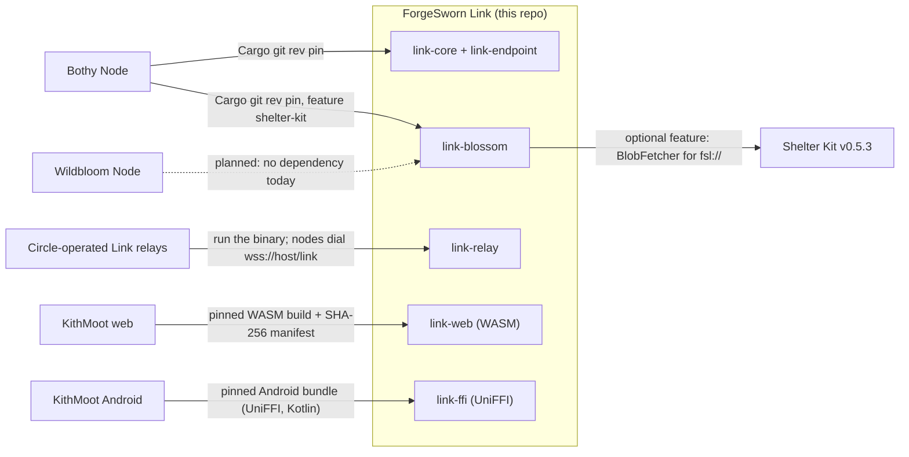

# Where ForgeSworn Link fits

ForgeSworn Link is the wide-area transport lane in the ForgeSworn storage family: a Rust workspace of unpublished crates that gives two nodes a QUIC direct path where one exists and an opaque WebSocket relay where it does not. It carries a hash-addressed blob-fetch protocol (`link-blossom`) and a paired-route engine for browsers and phones (`link-engine`). It stores nothing and decides nothing about who may read what; the products that consume it do that.

| Neighbour | Relationship | Interface | Status |
| --- | --- | --- | --- |
| Bothy Node | Consumer; uses the lane to mirror and repair between machines | Cargo git dependencies on `link-core`, `link-endpoint` and `link-blossom` (feature `shelter-kit`), pinned by rev (`7aad8bf` when checked) | Built |
| KithMoot web | Consumer of the browser engine | `link-web` compiled to `wasm32-unknown-unknown` by `scripts/build-link-web.sh --target web`; relay-only, `wss://` relays verified against WebPKI roots; KithMoot records the Link commit and file hashes in its own manifest | Built |
| KithMoot Android | Consumer of the native bridge | `link-ffi` (UniFFI, Kotlin package `dev.forgesworn.link.ffi`) from `scripts/build-android-bundle.sh`; CI uploads `link-ffi-android-<commit>` and KithMoot pins the commit and digest | Built; native compilation proven, no physical-device run |
| Shelter Kit | Optional dependency of `link-blossom` | Cargo feature `shelter-kit`, `shelter-kit` git tag `v0.5.3`; `LinkFetcher` implements `shelter_kit::BlobFetcher` and answers `fsl://<node-id-base32>/<sha256>[.<ext>]`, rejecting other schemes | Built |
| Wildbloom Node | Planned consumer, in place of Tor-only mirroring | None. It mirrors over Tor or HTTPS today | Planned |
| Circle-operated Link relays | Operators run `link-relay`; nodes dial it | `link-relay` binary: WebSocket datagram relay at `/link` plus a stateless UDP reflector; relay URLs are card hint `0x01` or endpoint configuration | Built; `link1.forgesworn.dev` switched off 2026-10-22 |

## What this repo leaves to others

- Storage, retention, quotas and BUD authorisation: Shelter Kit. `link-blossom` serves through a `BlobSource` the node supplies and fetches through Shelter Kit's `BlobFetcher`.
- Finding a peer's current card: the node supplies a `CardResolver` (`link-blossom`). Link runs no discovery service.
- Consent, room and event semantics, pairing flow and user interface: the consuming product. A paired route is reachability only; it does not identify a Nostr account or grant a capability (`docs/PAIRED-RENDEZVOUS.md`).
- Running a relay: whoever operates it. No ForgeSworn hostname is mandatory or default in the wire format (`SPEC.md` section 2.2). `link1.forgesworn.dev` could not be limited to its operator's own nodes, so it was closed and ForgeSworn does not run a public relay (`deploy/founders/README.md`). `deploy/founders/` records how that deployment worked.
- Cryptography, TLS and QUIC: `quinn`, `rustls`, `ed25519-dalek` and the other upstream crates named in the README.

## Not built yet

- A Wildbloom Node lane. Wildbloom Node has no Link dependency.
- A reopened shared relay. Bringing `link1` back closed needs an operator admission key in the tag-mode `Register` frame, with a matching client change (`deploy/founders/README.md`).
- Recorded phone and hostile-network runs: a handset on a carrier network, Android background operation, and a direct path between two hostile NATs. The README lists these under "What this does NOT prove".

Checked against forgesworn-link 7aad8bf, shelter-kit v0.5.3, kithmoot a7129a90 and kithmoot-android d387de4f on 6 November 2026.
